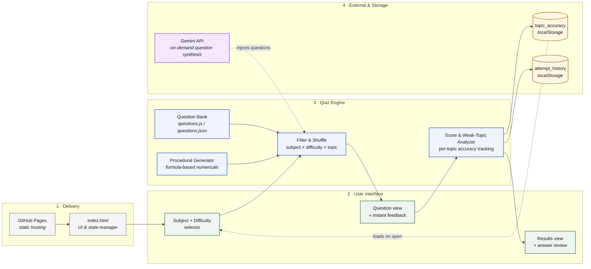

# JEE Quiz Studio

A modern, zero-dependency quiz and practice studio for JEE-level Physics, Chemistry, and Mathematics — featuring 450+ built-in questions, procedural formula-based generators, on-demand AI question synthesis, and per-topic accuracy tracking to surface weak areas over time.

🔗 **Live App:** https://happ3ns.github.io/JEE-Quiz-Generator/

---

## Features

- **Multi-Page Web Architecture:** Seamless client-side routing across 5 dedicated modules: Practice Studio, Syllabus Explorer, Mock Center, Analytics, and Formula Vault.
- **Three-Tier Syllabus Explorer:** Complete hierarchical tree navigation (Sections → Subsections → Sub-subsections) covering Physics, Chemistry, and Mathematics with instant topic drills.
- **Computer-Based Test (CBT) Mock Center:** Realistic NTA-style timed test environment with section switching and official JEE Mains (+4 / -1) negative marking.
- **KaTeX Mathematical Equations:** High-performance LaTeX rendering for complex integrals, kinetic rates, and vectors.
- **Persistent Diagnostic Analytics:** Local storage accuracy matrix tracking strong and weak areas with percentile estimates.
- **Verified Question Bank & Procedural Generators:** 450+ multi-tier conceptual questions and automated Gemini API batch generation tooling.
- **Zero Build Setup:** Runs directly in any browser on GitHub Pages with zero external build dependencies.

---

## Architecture



---

## Project Structure

```
├── index.html                  # Semantic application markup & CDN integrations (KaTeX, Confetti)
├── css/                        # Modular stylesheet architecture
│   ├── theme.css               # Design tokens, fonts, colors, and resets
│   ├── layout.css              # Masthead, responsive grid, card containers
│   ├── components.css          # Subject cards, segmented controls, option rows, solution drawer
│   ├── navigation.css          # Tab navigation, breadcrumbs, 3-tier syllabus tree & mock cards
│   └── results.css             # Score gauge, stats grid, topic mastery bars, review list
├── js/                         # Modular JavaScript application engine
│   ├── state.js                # App state, localStorage persistence, Web Audio synth
│   ├── taxonomy.js             # 3-tier JEE hierarchy (Sections, Subsections, Topics) & formulas
│   ├── marking.js              # JEE Mains (+4 / -1) vs Standard scoring calculation
│   ├── katex-render.js         # KaTeX math auto-renderer
│   ├── router.js               # Client-side hash routing across application pages
│   ├── ui.js                   # Active quiz canvas, question pool, results controller
│   ├── views/                  # View modules
│   │   ├── syllabus-view.js    # Sections & sub-subsections matrix with search & drills
│   │   ├── mock-view.js        # CBT mock exam test center launcher
│   │   ├── analytics-view.js   # Diagnostic metrics, percentile estimate & history log
│   │   └── formulas-view.js    # High-yield KaTeX equation reference vault
│   └── app.js                  # App bootstrap, event wiring, and keyboard shortcuts
├── questions.js                # Modular question bank & procedural generator functions
├── questions.json              # Full 450+ validated questions exported for tooling/APIs
├── tools/
│   ├── validate_questions.py   # Automated validation script (checks bounds, duplicate text, keys)
│   └── generate_with_gemini.py # Automated batch question generator with Gemini
└── README.md
```

---

## Running Locally

No build step or bundler needed. Simply open `index.html` in your browser or run:

```bash
python3 -m http.server 8000
# Open http://localhost:8000 in your browser
```

---

## Automated Validation

To run automated checks across the question bank (verifying answer bounds, field schemas, and duplicate questions):

```bash
python tools/validate_questions.py
```

---

## License

MIT — feel free to use, modify, and extend.
