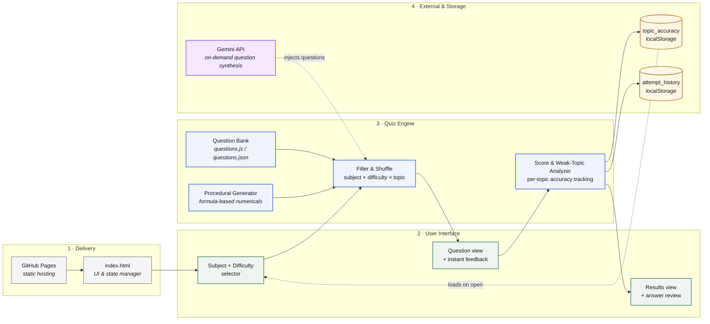

# JEE Quiz Studio

A modern, zero-dependency quiz and practice studio for JEE-level Physics, Chemistry, and Mathematics — featuring 450+ built-in questions, procedural formula-based generators, on-demand AI question synthesis, and per-topic accuracy tracking to surface weak areas over time.

🔗 **Live App:** https://happ3ns.github.io/JEE-Quiz-Generator/

---

## Features

- **450+ Verified Questions + Procedural Generators:** Covers Physics, Chemistry, and Mathematics across Easy, Medium, and Hard tiers.
- **⚡ On-Demand AI Generation:** Generate fresh, custom JEE questions in real time on any subject/topic using the integrated Google Gemini API.
- **Mock Exam & Practice Modes:** Timed multi-subject mock sessions (Chemistry → Physics → Maths) or focused practice with instant step-by-step explanations.
- **Smart Weak-Topic Tracker:** Automatically tracks your per-topic accuracy in `localStorage` across attempts to guide your revision.
- **Live Question Map & Side Rail:** Interactive navigation matrix showing status (answered, unanswered, correct, incorrect) in real time.
- **Zero Build Setup:** Runs directly in any browser with no dependencies or build steps required.

---

## Architecture



---

## Project Structure

```
├── index.html                  # UI, state management, timer, and AI generation controls
├── questions.js                # Modular question bank & procedural generator functions
├── questions.json              # Full 450+ validated questions exported for tooling/APIs
├── tools/
│   └── validate_questions.py   # Automated validation script (checks bounds, duplicate text, keys)
└── README.md
```

---

## Running Locally

No build step or bundler needed. Simply open `index.html` in your browser or run:

```bash
python3 -m http.server 8000
# Open http://localhost:8000 in your browser
```

---

## Automated Validation

To run automated checks across the question bank (verifying answer bounds, field schemas, and duplicate questions):

```bash
python tools/validate_questions.py
```

---

## License

MIT — feel free to use, modify, and extend.
